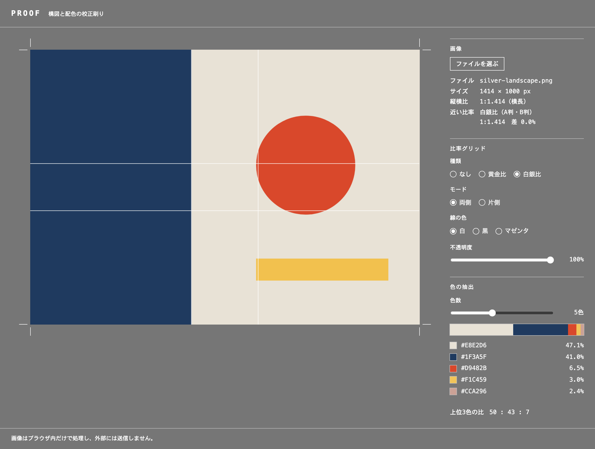
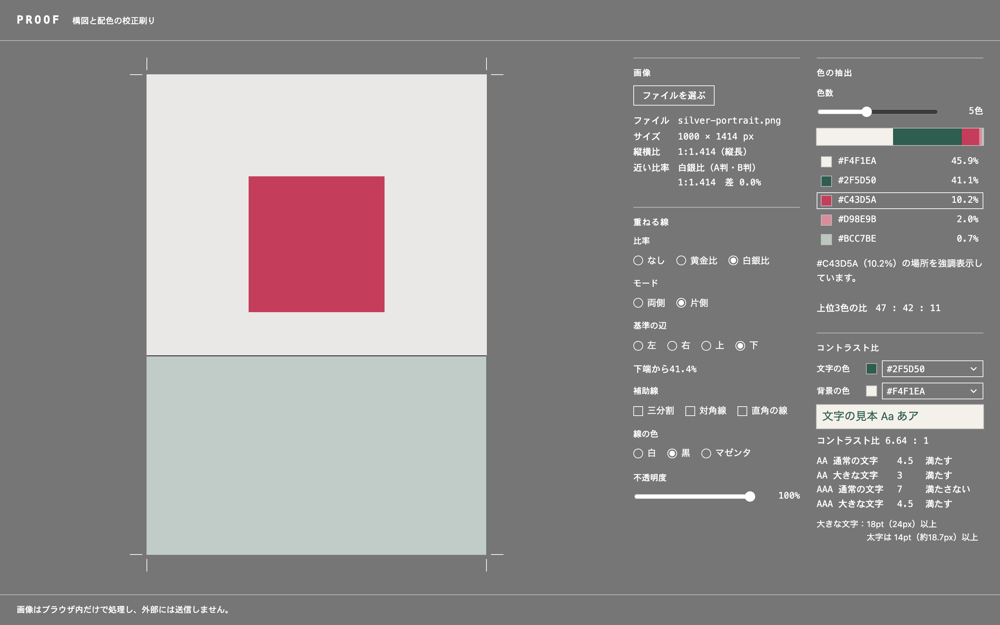

# PROOF

[](https://github.com/odditymana/proof/actions/workflows/test.yml)

画像の構図と配色を、自分の目で確かめるための Web アプリです。

**→ [https://odditymana.github.io/proof/](https://odditymana.github.io/proof/)**





PROOF は印刷の「校正刷り」のこと。自分のデザインの構図や配色を確かめ、言葉にするための補助ツールです。良し悪しの採点や自動判定はしません。数値は推測ではなく計測で出すので、同じ画像なら毎回同じ結果になります。

## 作った理由

フライヤーや Web バナーを作るとき、黄金比や配色を意識してはいても、実際には感覚で決めている部分が多くあります。その感覚が数字で見るとどうなっているのかを確かめ、言葉にしやすくするための道具として PROOF を作りました。

動機の一つは、ヒプノシス（Hipgnosis）のジャケットデザインです。あの構図や色彩感覚が好きで、自分の作るものでも「なぜそう見えるのか」を確かめながら作りたいと思いました。

音のアプリ [TEST PRESSING](https://odditymana.github.io/test-pressing/) と対になる、視覚のアプリです。TEST PRESSING がレコードのテスト盤なら、PROOF は印刷の校正刷り。どちらも、仕上げる前に自分の耳と目で確かめるための道具です。

## できること

- **画像の読み込み**：ドラッグ＆ドロップ、または「ファイルを選ぶ」
- **反転**：画像を左右・上下に反転して見る（見慣れて気づけなかった偏りを確かめるため）。重ねる線は画面の向きのままで、色の計測は変わらない
- **縦横比**：長辺÷短辺で計測し、1:1・4:3・3:2・白銀比・黄金比・16:9 のうち ±2% 以内で近い比率を表示
- **比率グリッド**：白銀比（1:1.414、A判・B判の用紙の比率）と黄金比（1:1.618）の線を画像に重ねる
  - 両側（縦横の両端から）／片側（左・右・上・下から1本）
  - 三分割、対角線、直角の線（角から対角線に直角に交わる線と、その線が長辺と交わる位置）も同時に重ねられる
  - 螺旋：黄金比か白銀比を選ぶ。画像を引き伸ばさず、その比率の長方形を巻き始めの角（4通りから選ぶ）に寄せて当てはめ、分割線と螺旋、螺旋の中心の位置を表示
    - 黄金螺旋：四分円をつないだ黄金螺旋（対数螺旋の近似。ずれは最大で短辺の約1.2%）
    - 白銀比の螺旋：A判の分割から作った螺旋。白銀比の長方形は半分に切ると同じ比率になる（A4→A5→A6）ので、半分に切り続け、切り取った半分ごとに四分の一の楕円をつないだもの（対数螺旋の近似。ずれは最大で短辺の約2.6%）。白銀比の画像では、螺旋の中心が三分割の交点と重なる
    - ここでの白銀比は 1:√2（A判・B判の比率）で、英語の silver ratio（1:1+√2 ≒ 1:2.414）とは別
  - 線の色（白・黒・マゼンタ）と不透明度
  - 縁取り：白い線の両側に薄い黒の縁を付け、明るい部分でも暗い部分でも線が見えるようにする
- **色の抽出**：メディアンカットで 3〜8 色に減色し、割合の帯、HEX 値、%、上位3色の比を表示
  - 色は画像を幅100pxに縮小して決め、割合は長辺1000pxに縮小した画像で数える。縮小して計測したときだけ現れた色は、隠さずに 0% として表示
  - 色リストの色を押すと、画像上でその色の場所を強調表示（ほかの部分は、暗いグレーと明るいグレーのうち、選んだ色と明るさの差が大きいほうに寄せる）
  - 同じ色をもう一度押すか、Esc キーで解除
- **コントラスト比**：文字の色と背景の色を、色リストから選ぶか HEX で入力し、WCAG のコントラスト比と、各基準（AA・AAA、通常の文字・大きな文字）を満たすかどうかを表示
- **欄の折りたたみ**：画像・重ねる線・色の抽出・コントラスト比の欄は、見出しを押すと閉じられる（閉じても設定はそのまま。開閉の状態はブラウザの中に覚える）

## プライバシー

画像はブラウザの中だけで処理し、外部には送信しません。サーバーへのアップロードや外部サービスとの通信はありません。

欄の開閉の状態（どの欄を閉じたか）だけを、ブラウザの中（localStorage）に保存します。画像や色の情報は保存しません。

## 手元で動かす

JavaScript を機能ごとのファイル（ES Modules）に分けているため、`index.html` をダブルクリックで開く（`file://`）と動きません。簡易サーバーを使ってください。

```sh
python3 -m http.server 8000
# ブラウザで http://localhost:8000/ を開く
```

## テスト

計算の部分（縦横比、色の抽出、コントラスト比、HEX の読み取り、線と螺旋の位置）を、Node.js に標準で入っている `node:test` で確かめています。ライブラリは使いません（Node.js 22 以降）。

```sh
npm test
```

main への push と pull request のたびに、GitHub Actions で自動で走ります。

## 構成

HTML・CSS・JavaScript だけで作っています（フレームワーク・ライブラリなし）。

```
index.html
css/style.css
js/
  main.js          各機能をつなぐ入口
  image-loader.js  画像の読み込み
  ratios.js        比率の定数と縦横比の計測
  overlay.js       画像に重ねる表示の土台（レイヤー）
  flip.js          画像の反転
  lines.js         重ねる線の共通部分（線の色・縁取り・不透明度）
  grid.js          比率グリッド
  thirds.js        三分割
  diagonals.js     対角線と、対角線に直角に交わる線
  spiral.js        螺旋（黄金比・白銀比）
  line-panel.js    「重ねる線」の欄で、どの段を出すか
  palette.js       色の抽出（メディアンカット）
  palette-view.js  色の抽出結果の表示
  highlight.js     色の場所の強調表示
  contrast.js      コントラスト比の計算と、HEX の読み取り
  contrast-view.js コントラスト比の表示
  sections.js      パネルの欄の折りたたみ
tests/             計算のテスト（node:test）
test-images/       動作確認用の自作画像
package.json       テストを動かすコマンド（依存なし）
.github/workflows/test.yml  GitHub Actions でテストを走らせる設定
```

## 公開

GitHub Pages で公開する前提です。ビルドは不要で、リポジトリのルートをそのまま公開します。

## ライセンス

- コード：[MIT License](LICENSE)
- テスト画像（`test-images/`。元の HTML を含む）：[CC0 1.0](test-images/LICENSE)（パブリックドメイン）
